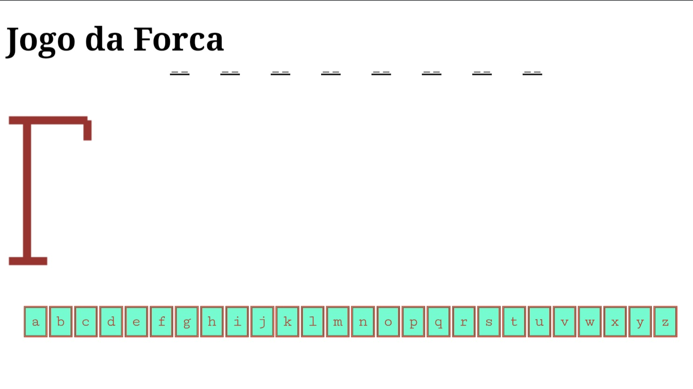
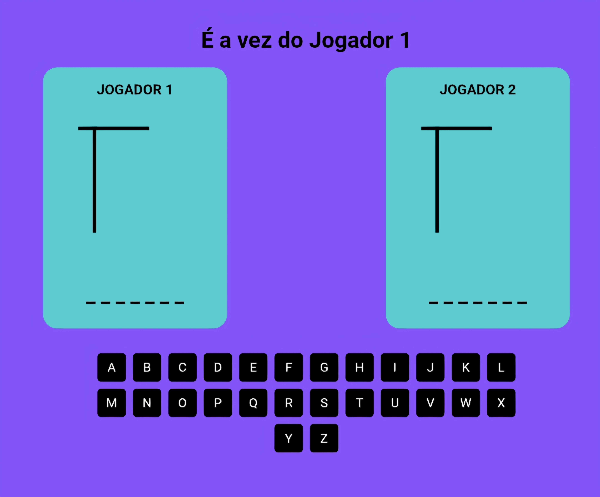

# 🎮 Hangman Game

Jogo da forca desenvolvido em JavaScript, com proposta de partida para dois jogadores e teclado virtual integrado.

## 📌 Sobre

Este projeto foi desenvolvido como trabalho final da disciplina de Desenvolvimento Web I, no curso Técnico em Informática do Instituto Federal do Ceará (IFCE).

A proposta consistiu na criação de um jogo da forca para dois jogadores, permitindo que cada participante tivesse sua vez de jogar por meio de um teclado virtual integrado à interface.

Além da versão desenvolvida em grupo, também criei uma versão individual simplificada para estudar e compreender melhor a lógica necessária para implementar o jogo.

## 🖥️ Preview

Versão individual — Estudo e aprendizagem

Versão final — Projeto em grupo

## ✨ Funcionalidades

- Jogo da forca para dois jogadores.
- Alternância de turnos entre os participantes.
- Teclado virtual integrado.
- Identificação de letras utilizadas.
- Mecânica de tentativas e descoberta da palavra.

## 🛠️ Tecnologias utilizadas

- HTML5
- CSS3
- JavaScript

## 🔄 Processo de desenvolvimento

O projeto possui diferentes etapas que representam sua evolução:

### 1. Versão individual — "versaoesthefany"

Primeira implementação simplificada, desenvolvida individualmente com o objetivo de compreender a lógica do jogo e praticar os conceitos de HTML5 e JavaScript.

### 2. Versão intermediária

Etapa de evolução da implementação, com experimentações e desenvolvimento das funcionalidades do jogo.

### 3. Versão final

Versão desenvolvida em equipe como trabalho final da disciplina, com a proposta de oferecer uma experiência de jogo para dois participantes.

## 📚 Referência de estudo

Durante o desenvolvimento da versão individual, utilizei como material de estudo:

Livro: O Guia Essencial do HTML5: Usando jogos para aprender HTML5 e JavaScript.
Autora: Jeanine Meyer.

A leitura contribuiu para meu aprendizado e compreensão dos conceitos utilizados na implementação.

## 👥 Equipe

A versão final foi desenvolvida em grupo, com a colaboração de três integrantes.

- Esthefany Souza
- Caio Bernardino 
- Hercullys Rocha

## 📚 Aprendizados

- Lógica de programação aplicada a jogos.
- Manipulação de elementos HTML.
- Eventos e interações com JavaScript.
- Implementação de teclado virtual.
- Controle de turnos e tentativas.
- Desenvolvimento colaborativo.
- Evolução de uma implementação a partir de versões experimentais.

## 🎯 Contexto acadêmico

- Instituição: IFCE
- Curso: Técnico em Informática
- Disciplina: Desenvolvimento Web I
- Modalidade: Individual (versão de estudo) e em grupo (versão final)

## 🌐 Acesse o projeto

🔗 Site: https://esthefanysouza.github.io/Hangman-Game/ (versão inicial)
https://esthefanysouza.github.io/Hangman-Game/versaofinal/paginainicial.html (versão final)
💻 Código: https://github.com/esthefanysouza/Hangman-Game/tree/main

## 👩‍💻 Autoria

Desenvolvido por Esthefany Souza, em colaboração com os demais integrantes da equipe na versão final.
